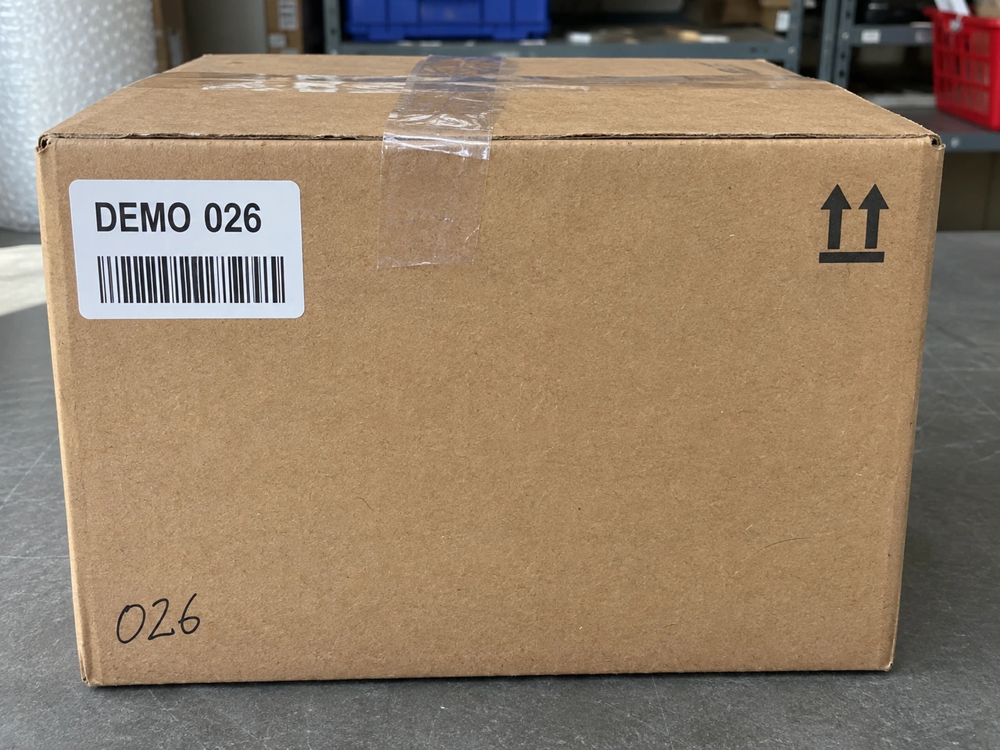
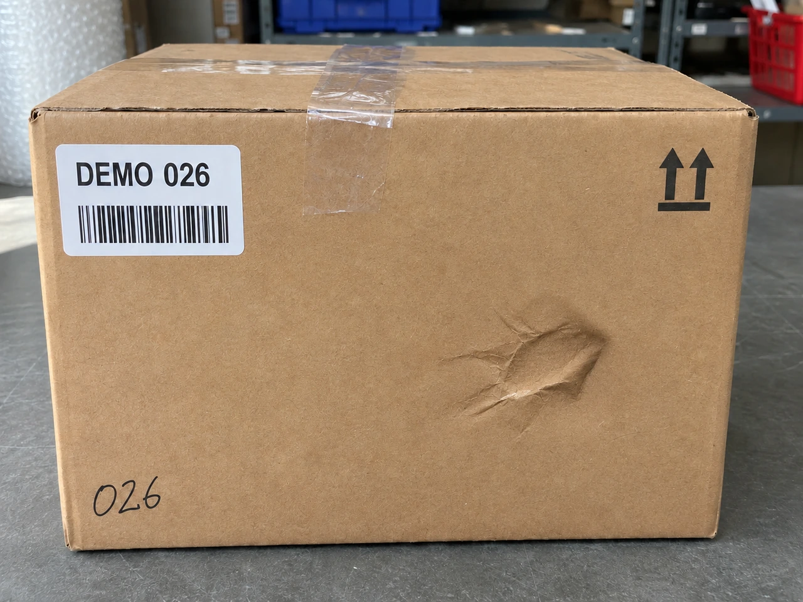

# ParcelLedger

ParcelLedger helps online shops and their customers document the condition of a parcel before shipping and when it arrives. Both parties can compare the original photos, review visible changes, and sign a shared condition report. For orders with a deposit, they can also use that report to agree on a payout through an escrow contract on Avalanche Fuji.

**[Watch the official demo (2 min 33 sec)](output/demo/ParcelLedger_UniHack_2026_Final.mp4?raw=true)** · [Vietnamese subtitles](output/demo/ParcelLedger_UniHack_2026_Final.vi.srt)

Follow a ceramic lamp shipment from packing photos to a signed report, then see how a funded shipment is settled on Avalanche Fuji.

[Pitch deck](output/pitch/ParcelLedger_UniHack2026.html) · [Sample signed report](output/pdf/Bien_ban_mau_co_chu_ky.pdf) · [Escrow on Avalanche Fuji](#escrow-on-avalanche-fuji) · [Run locally](#run-locally)

## Built for UniHack 2026

We built ParcelLedger for **Team1 Vietnam UniHack 2026**, a student hackathon in Vietnam focused on building applications on Avalanche. We chose a problem familiar to shops that pack and ship fragile goods themselves. When a customer reports damage, what evidence would help both sides reach a decision, and how could they check that a payment follows the decision they signed? [Competition website](https://team1vn.xyz/)

The prototype brings two tools into the same claim. Computer vision helps people find comparable photos of a parcel taken at different times. For a funded shipment, Avalanche gives the sender and recipient a public record of the report they approved and the funds each can withdraw. A shop can also use the photo and reporting workflow on its own.

## The delivery problem

Consider a ceramics shop sending a lamp. On delivery, the customer sends the shop a close-up of a dented box. The packing team has several photos of the order, taken from different sides. Before anyone can discuss a refund, someone has to find the dispatch photo showing that same panel. A different camera angle, a shadow, or a crease already present at dispatch can change what the two people think they see.

Even when they find the right images, the outcome can be hard to reconstruct from a chat. Which mark did the customer point out? Did both people see the latest note? What did they agree to do about it? ParcelLedger keeps the original photos, observations, and report versions under the shipment reference, so the next person handling the case can pick up where the last one left off.

| At dispatch | At delivery |
|:---:|:---:|
|  |  |

*Generated photos from the ceramic lamp example. The lower-right panel is visibly dented in the delivery photo. The photos alone cannot establish when or how the dent occurred.*

## Who uses ParcelLedger?

| Participant | What they can do |
|---|---|
| **Packing staff** | Create a shipment, photograph the relevant faces of the parcel, and seal the dispatch photo set before handing it over. |
| **Recipient** | Open the shop’s invitation, add an overview and a close-up of the area in question, and review the original photos alongside the shop’s observations. |
| **Claims staff** | Find an order by reference, item, or recipient. Filter the inbox to see which shipments still need delivery photos, comparison, or confirmation. Reopen a case to review its history across shifts. |

## Walk through the product

1. **Capture.** The sender opens a shipment, photographs the parcel, and shares an invitation. The recipient adds photos of the same face at delivery.
2. **Compare.** The app matches views, aligns the images, and highlights regions worth inspecting. When the photos have too little overlap or detail, the workflow can ask for another view.
3. **Review and sign.** The parties can correct a draft observation or add context while reviewing the original images. An edit creates a new report version. Each party can sign the version they reviewed with a typed name or a drawn signature. Both can download a readable PDF and the canonical JSON used to verify its contents.
4. **Settle an optional deposit.** For a funded shipment, the two wallets sign the terms, the report approval, and the allocation separately. Each party withdraws its share. A disputed case can go to a Safe with a two-of-three threshold.

## Escrow on Avalanche Fuji

The original photos, names, and contact details stay in the application. The public chain records the report fingerprint, wallet approvals, and fund movements. Either party can inspect the settlement independently of the shop’s dashboard.

Each funded shipment has its own escrow contract on the **Avalanche Fuji C-Chain (43113)**. The sender deposits kcTEST, and test AVAX covers network fees. Approving the condition report records which version both parties signed. The funds stay in escrow until the parties agree on an allocation or the Safe resolves a dispute.

The two public examples below show the agreed and disputed paths. Each amount links to the corresponding withdrawal.

| Case | Allocation transaction | Sender withdrew | Recipient withdrew | Final escrow balance |
|---|---|---:|---:|---:|
| [Mutual agreement][agreement-escrow] | [Both parties approved][settle] | [7 kcTEST][agree-sender] | [3 kcTEST][agree-recipient] | 0 kcTEST |
| [Dispute][dispute-escrow] | [Safe resolution][resolve] | [6 kcTEST][dispute-sender] | [4 kcTEST][dispute-recipient] | 0 kcTEST |

The mutual-agreement example includes the same report in two forms. The PDF is the copy people read. The JSON is the record whose fingerprint appears in the on-chain approval, so either party can check which version the wallets accepted. [Report PDF](artifacts/evaluation/fuji-evidence/report-v1.pdf) · [Canonical JSON](artifacts/evaluation/fuji-evidence/report-v1.json) · [Report approval][accept-report]

Dispute resolution requires signatures from two distinct Safe owners. One operator controlled all three test keys in this demonstration. The repository includes the deployed contract addresses and the transaction records for both cases. [Deployment manifest](artifacts/deployments/fuji.json) · [Transaction log](artifacts/evaluation/fuji-chain-integration.json) · [Withdrawal records](artifacts/evaluation/fuji-evidence/rpc.json)

## Run locally

Use **Git**, **Docker with Linux containers**, and **Docker Compose 2.24.4 or later**. The Fuji configuration uses a Linux amd64 MinIO image. You can view the recorded evidence and sign ordinary reports without a wallet or test funds.

```sh
git clone https://github.com/Solitudeshu/ParcelLedger-UniHack2026.git
cd ParcelLedger-UniHack2026

docker compose -p kienchung-fuji -f infra/compose.yaml -f infra/compose.fuji-demo.yaml build api web minio
docker compose -p kienchung-fuji -f infra/compose.yaml -f infra/compose.fuji-demo.yaml up -d --no-build api worker outbox reconciler
docker compose -p kienchung-fuji -f infra/compose.yaml -f infra/compose.fuji-demo.yaml exec -T api python -m scripts.bootstrap
docker compose -p kienchung-fuji -f infra/compose.yaml -f infra/compose.fuji-demo.yaml up -d --no-build web
```

The [web app](http://127.0.0.1:23000) and [API documentation](http://127.0.0.1:28000/docs) run on your machine. The [readiness endpoint](http://127.0.0.1:28000/health/ready) reports database and storage availability. The [network configuration](http://127.0.0.1:28000/v1/config) should show chain ID `43113` and the factory from the deployment manifest.

**Try a shipment on a fresh installation.** Seed four sample cases, then open the sender workspace and search for `DEMO-PL-LAMP`. In a separate browser profile or private window, enter as the recipient to review the same shipment. The Vietnamese role buttons are **Vào vai người gửi** (sender) and **Vào vai người nhận** (recipient). The [public Fuji examples](#escrow-on-avalanche-fuji) can be inspected independently of your local database.

```sh
docker compose -p kienchung-fuji -f infra/compose.yaml -f infra/compose.fuji-demo.yaml exec -T api python -m scripts.seed_showcase
```

## Architecture

| Component | Responsibility |
|---|---|
| [Web application](apps/web) | Next.js and TypeScript implement the two workspaces, photo comparison, report signatures, and wallet interactions. |
| [API](services/api) and [workers](services/worker) | FastAPI manages shipment access, uploads, and report exports. Workers compare images and reconcile escrow events. PostgreSQL stores shipment records and MinIO stores photos. |
| [Contracts](contracts/src) and [ABIs](packages/chain) | The factory creates one escrow per case. Solidity contracts verify EIP-712 approvals, record evidence commitments, and enforce allocation and withdrawal rules. Photos stay in object storage. |
| [Evidence schema](packages/evidence-schema) and [canonicalization](services/api/canonical.py) | The API normalizes report content and serializes it consistently. Cross-language test vectors check that the same content produces the same bytes. |
| [Vision research](ml) and [notebooks](notebooks) | Training and evaluation code cover photo matching, alignment, and change detection. The local demo runs the geometry baseline without a GPU or downloaded model weights. |

## Image matching results

The demo uses SIFT features and RANSAC to align comparable views. It flags visible differences for the sender and recipient to inspect.

The research matching policy selected the correct reference in **220 of 228** held-out synthetic queries, with **218** also meeting the alignment criterion. On staged TAMPAR photos of **20 boxes**, it selected the correct reference for **7 of 40** full views and **32 of 40** close-up crops. In a separate test where every candidate was the wrong box, it accepted one close-up match. These measurements describe reference selection under the stated conditions. Damage assessment and responsibility remain human decisions. [Synthetic evaluation](artifacts/evaluation/correspondence-final-test-v1.json) · [TAMPAR evaluation](artifacts/evaluation/tampar-matching-v1.json)

## How we would evaluate it in a shop

The first proposed pilot is a ceramics or home décor shop that packs its own orders and handles its own delivery claims. The practical question is whether recording dispatch photos pays off when a claim arrives. The shop would compare similar cases handled through its usual process and through ParcelLedger.

At the packing desk, we would measure the extra time spent taking photos per shipment. During a claim, we would measure how long staff take to find a usable pair, how often they ask the customer for another view, and how long it takes both parties to sign. Those observations would tell us whether to improve capture guidance, image matching, or the report review screen first.

## Development checks

Use **Node.js 24** and npm from the repository root. Windows x64 uses the Forge binary installed by npm. On Linux or macOS, install Foundry so that `forge` is on your path.

```sh
npm ci
npm run test:schemas
npm run build
npm run typecheck
node scripts/foundry.mjs forge test
```

With the local stack running, the following API tests cover PDF generation, the shipment workflow, and chain-event reconciliation. They use a dedicated PostgreSQL test database.

```sh
docker compose -p kienchung-fuji -f infra/compose.yaml -f infra/compose.fuji-demo.yaml exec -T api python -m pytest -q tests/python/test_report_pdf.py tests/python/test_workflow.py tests/python/test_reconciler.py
```

[agreement-escrow]: https://build.avax.network/explorer/fuji/c-chain/address/0x97dAbFf00BdB800f48C7f290A77a8Add586b922a
[dispute-escrow]: https://build.avax.network/explorer/fuji/c-chain/address/0x2e1C7D26a6358d287fFDF36590bf982B96ffb5C1
[settle]: https://build.avax.network/explorer/fuji/c-chain/tx/0x791ddea8fa84a8b5a248e07bd7154b12c985d97ac1e58d3ea65287a8fb25edf7
[resolve]: https://build.avax.network/explorer/fuji/c-chain/tx/0xdbf754dfbec2d1a3700b093541573df5e5b6348fab5503c596d338ac0e82b9c0
[agree-sender]: https://build.avax.network/explorer/fuji/c-chain/tx/0xec41279669095da7a35d8d73ec6c780374bca68dcde58d2c021d5a1804a632d7
[agree-recipient]: https://build.avax.network/explorer/fuji/c-chain/tx/0x3df46e459ea7866c71e66b0349ec3d127e0dd6a6e5b6d55241695daea92749e1
[dispute-sender]: https://build.avax.network/explorer/fuji/c-chain/tx/0x166bac22f42bf38797a1bbd7bc7ce69e9f068ce9b550d8134ac10f5506814fb6
[dispute-recipient]: https://build.avax.network/explorer/fuji/c-chain/tx/0x51bf1a73a601906c22e8a379e686b041fe0eb9945692559cd3ed5e90c7f28614
[accept-report]: https://build.avax.network/explorer/fuji/c-chain/tx/0x32b0e646fe314a8f9dc56d2187619d039174913bb86b2828d40c15fe55395770
